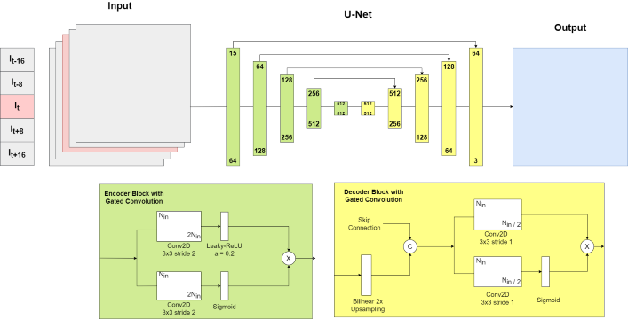
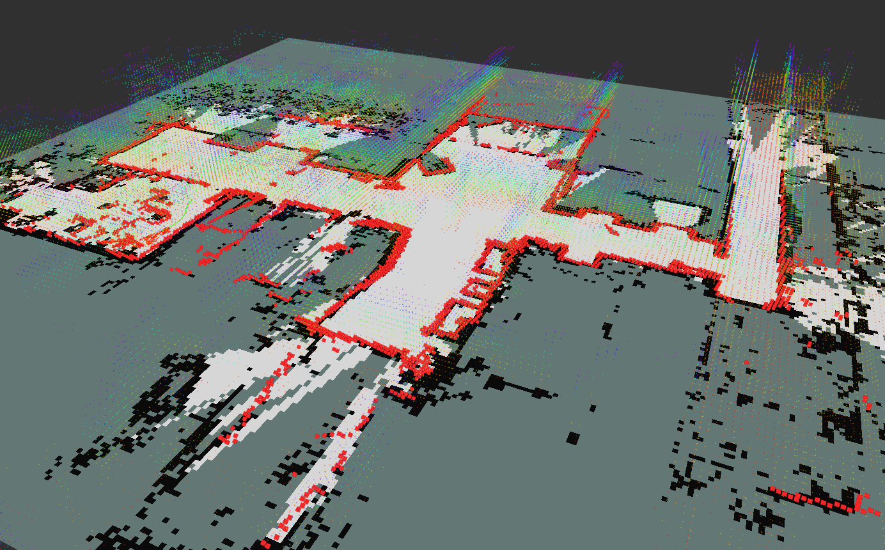
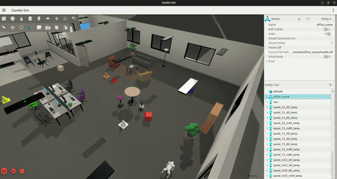
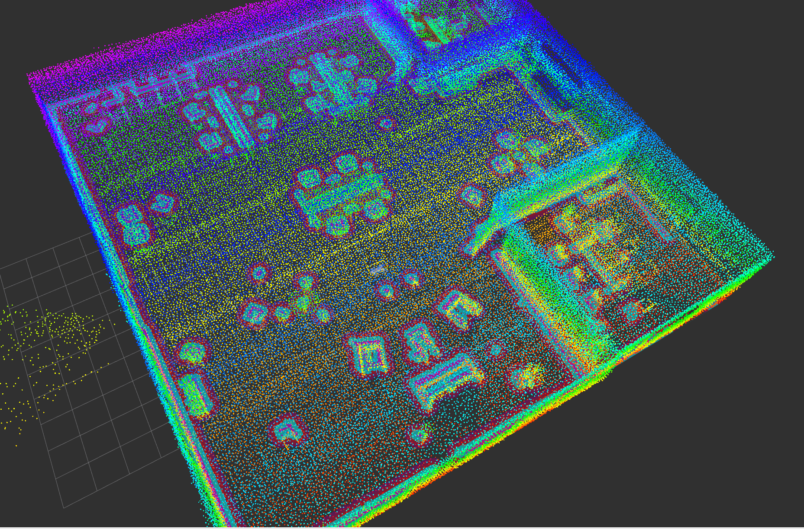
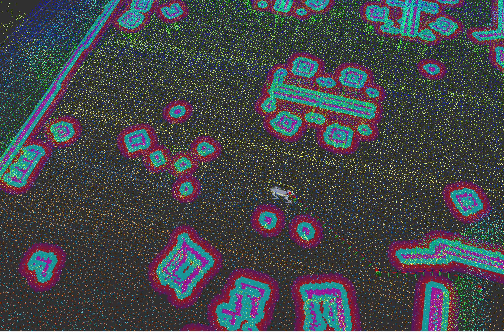

# **Robotics & Computer Vision Engineer** 🤖  

- **MEng in Electrical Engineer & Computer Science**  
-  Passionate about machine learning, with expertise in transforming research papers into efficient code implementations, training neural networks, and building real-world AI applications, and deploying them on legged robots (Unitree Go2 & G1).  

## **Experience** 💼
- **Robotics / Computer Vision Engineer** @ EY – Greece, Robotics Lab, 2026 – Present  
  • Back at EY since April 2026, now part of the Robotics Lab developing autonomous robotic surveillance systems.  
  • Building mapping and autonomous / semantic navigation pipelines for quadruped robots and drones.  
  • Implemented visual servoing capabilities for drones for vision-based target tracking and approach.  
  • Working across perception, navigation and control for legged and aerial robotic platforms.

- **Computer Vision Engineer** @ I-SENSE Group / ICCS, 2025 – 2026  
  • Implemented a semantic 3D Scene Understanding algorithm where users can search for objects using simple text queries.  
  • Worked with 3D projection, pointclouds and voxel grids, and 2D foundation models like DINO, CLIP and SAM.  
  • Utilized SOTA techniques for handling large amounts of unstructured 3D data and vector search.

- **Junior Machine Learning Engineer / AI Consultant** @ EY – Greece, 2024 – 2025 🌍  
  • Gained in-depth familiarity with NLP concepts and best practices.  
  • Implemented GenAI architectures like Multi-Agent Systems, RAG and more.  
  • APIs and Integration: Designing and implementing RESTful APIs to deploy models in production environments.  
  • Exploratory Data Analysis (EDA): Strong ability to visualize and interpret data to uncover insights.  
  • Client-Facing Communication: Experience presenting technical findings and recommendations to clients and stakeholders.

- **Diploma Thesis** 📝 – [Deep Learning Video Stabilization](/assets/thesis.pdf):
   
     
   • Gained in-depth knowledge of Computer Vision concepts by implementing and modifying numerous research papers.  
   • Became proficient in Deep Learning training principles and best practices.  
   • Used state-of-the-art techniques such as Deep Perceptual Losses, Transfer Learning, feature embeddings, and fine-tuning.  
   • Leveraged advanced network architectures like channel attention, gated convolutions, and more.  
   • Implemented advanced training schemes such as cGAN, WGAN, Siamese Networks, and more.  
   • Mastered best practices for data preprocessing.  
   • Proposed two novel approaches for generating realistically unstable videos for supervised training:  
     • Approach 1: Trained a model to generate realistic motion noise.  
     • Approach 2: Utilized Principal Component Analysis for noise generation.
     

## **Robotics** 🤖
Hands-on work deploying **Unitree Go2 (quadruped)** and **Unitree G1 (humanoid)** robots on real hardware, in **NVIDIA Isaac Sim / Isaac Lab**, and in **Gazebo**, with ROS 2 as the common backbone.

### 🦾 Real robots: SLAM, navigation & skills framework
[**Unitree-Go2-and-G1-SLAM-navigation-and-skills-framework**](https://github.com/btxviny/Unitree-Go2-and-G1-SLAM-navigation-and-skills-framework)

- Autonomous mapping and navigation on a real **Go2 EDU** (Hesai XT16 LiDAR, RealSense) and **G1** (Livox Mid360), both running at the same time.
- LiDAR odometry (**KISS-ICP**) + **slam_toolbox** run on the robot's dock inside Docker; **Nav2**, RViz2, frontier exploration and AMCL map-to-map localization run on a workstation over CycloneDDS.
- Localization in a saved global map, offline map building from bags, and a velocity bridge from Nav2 to the Unitree SDK (`SportClient` / `LocoClient`).
- G1 skills: arm kinematics (Pinocchio IK) driven by **QR-code detection** from the head camera, Inspire dexterous hands, text-to-speech and speech-to-text.
- A **FastAPI** service exposing one HTTP contract for both robots plus a **Streamlit** control UI (telemetry, skills, localization, speech) for orchestration.

### 🧪 Isaac Sim: RL locomotion + SLAM-ready office
[**Isaac-Sim-SLAM-with-Go2-and-G1**](https://github.com/btxviny/Isaac-Sim-SLAM-with-Go2-and-G1)

- Trained walking policies for the Go2 and a custom 23-joint G1 with **RSL-RL (PPO)** in Isaac Lab.
- Office scene with simulated RTX lidar and RealSense cameras published to ROS 2 through OmniGraph.
- Policies deployed as separate **ROS 2 nodes** (TorchScript/ONNX), closing the loop over `/obs` and `/joint_commands` at 200 Hz physics.

### 🏢 Gazebo: Go2 office navigation
[**Unitree-Go2-Simulation-in-Gazebo**](https://github.com/btxviny/Unitree-Go2-Simulation-in-Gazebo)

- Go2 with head-mounted RGBD camera and back-mounted 3D lidar in a procedurally generated office (Blender → SDF → Gazebo Harmonic, ROS 2 Jazzy).
- **KISS-ICP** / **FAST-LIO2** odometry, SLAM, **Nav2** point-to-point navigation and autonomous **frontier exploration**.

  
  

**Stack:** ROS 2 (Humble/Jazzy) | Nav2 | slam_toolbox | KISS-ICP | FAST-LIO2 | Gazebo | Isaac Sim / Isaac Lab | RSL-RL | Docker | Unitree SDK2 | FastAPI | Streamlit

## **Education** 🎓  
- **MEng in Electrical Engineering and Computer Science**  
  *University of Patras*  
  *Specialization*: Computer Software & Hardware  
  *Diploma Thesis*: **Deep Learning Video Stabilization**

## **Technical Skills** 🔧
PyTorch | TensorFlow |
Computer Vision | OpenCV | 
Natural Language Processing | RAG | MultiAgent - Applications | Autogen | LangChain | LangGraph |
ROS 2 | Nav2 | SLAM | Visual Servoing | Drones | Isaac Sim | Gazebo | Reinforcement Learning (RSL-RL) |
Distributed Training | Docker | GCP | Azure |
Signal Processing | Matlab | OpenMP | x86 Assembly | Parallel Computing | SQL  

## **Soft Skills** ✨  
*Attention to Detail* | *Leadership* | *Resourcefulness* | *Communication*

## **Projects** 🔍  
  

- 🎥 Implemented various Computer Vision projects such as:  
  - Real-time face verification using pretrained model embeddings.  
  - Semantic segmentation from drone footage.  
  - Neural style transfer and Stable Diffusion models.  
  - Sign language detection using human pose models.  
- 📊 Created numerous Kaggle notebooks on:  
  - Natural Language Processing: User review sentiment analysis.  
  - Time-series forecasting and regression models.

## **Hobbies & Interests** 🎾🎶🔌  
*Tennis* | *Music Playing* | *Electronics* | *Agriculture* | *Cooking*
